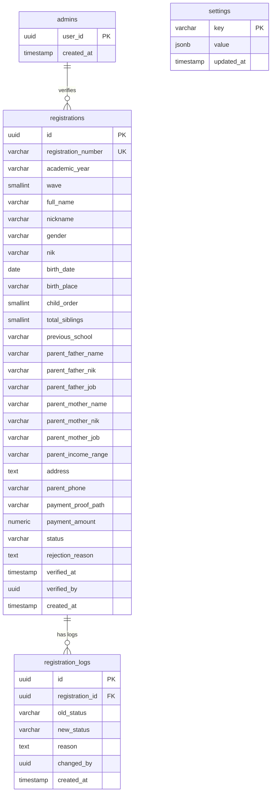

# Dokumentasi Teknis & Operasional
# Website Resmi & Sistem Penerimaan Murid Baru (SPMB) SDIT Fajar

Dokumen ini berisi dokumentasi lengkap mengenai arsitektur sistem, struktur kode, alur bisnis, skema basis data, tata cara instalasi, serta panduan operasional untuk **Website Resmi Sekolah Dasar Islam Terpadu (SDIT) Fajar Depok** beserta platform **Sistem Penerimaan Murid Baru (SPMB / PPDB Online)**.

---

## DAFTAR ISI

1. [Tentang SDIT Fajar & Proyek Ini](#1-tentang-sdit-fajar--proyek-ini)
2. [Arsitektur & Tumpukan Teknologi (Tech Stack)](#2-arsitektur--tumpukan-teknologi-tech-stack)
3. [Struktur Direktori Proyek](#3-struktur-direktori-proyek)
4. [Fitur & Modul Aplikasi](#4-fitur--modul-aplikasi)
   - [4.1 Website Profil Sekolah (Landing Page)](#41-website-profil-sekolah-landing-page)
   - [4.2 Portal Penerimaan Murid Baru (SPMB)](#42-portal-penerimaan-murid-baru-spmb)
   - [4.3 Dasbor Pengelolaan Panitia (Admin Portal)](#43-dasbor-pengelolaan-panitia-admin-portal)
   - [4.4 Background Jobs & Keamanan](#44-background-jobs--keamanan)
5. [Skema Basis Data & Penyimpanan (Supabase)](#5-skema-basis-data--penyimpanan-supabase)
   - [5.1 Entitas & Relasi Tabel](#51-entitas--relasi-tabel)
   - [5.2 Kebijakan Row Level Security (RLS)](#52-kebijakan-row-level-security-rls)
   - [5.3 Konfigurasi Bucket Storage](#53-konfigurasi-bucket-storage)
6. [Panduan Instalasi & Pengembangan Lokal](#6-panduan-instalasi--pengembangan-lokal)
   - [6.1 Prasyarat Sistem](#61-prasyarat-sistem)
   - [6.2 Variabel Lingkungan (.env)](#62-variabel-lingkungan-env)
   - [6.3 Menjalankan Proyek](#63-menjalankan-proyek)
   - [6.4 Perintah CLI (Scripts)](#64-perintah-cli-scripts)
7. [Panduan Operasional & Administrasi](#7-panduan-operasional--administrasi)
   - [7.1 Pembuatan Akun Admin Baru](#71-pembuatan-akun-admin-baru)
   - [7.2 Verifikasi dan Penolakan Pendaftar](#72-verifikasi-dan-penolakan-pendaftar)
   - [7.3 Manajemen Pengaturan SPMB](#73-manajemen-pengaturan-spmb)
   - [7.4 Ekspor Data Pendaftar](#74-ekspor-data-pendaftar)
8. [Panduan Deployment ke Produksi](#8-panduan-deployment-ke-produksi)

---

## 1. Tentang SDIT Fajar & Proyek Ini

**SDIT Fajar** adalah lembaga pendidikan dasar Islam terpadu yang berlokasi di:
> **Alamat**: Jl. Jati III No.40 RT.007/007, Kel. Jatijajar, Kec. Tapos, Kota Depok, Jawa Barat 16451  
> **Motto**: *"Membina Generasi Qur'ani yang Cerdas, Mandiri, dan Berakhlak Mulia"*  
> **Narahubung**: Ustadz M Fadil Riswandi (`0877-3786-0657`) & Ustadzah Viny Virzana (`0822-4962-7864`)  
> **Email**: `sditfajar@gmail.com` | **Instagram**: `@sdit_fajar`

### Tujuan Pengembangan Sistem
Proyek ini menggabungkan profil institusi sekolah modern dengan otomatisasi proses pendaftaran peserta didik baru untuk menyelesaikan berbagai kendala konvensional:
- **Pengganti Formulir Manual / Google Form**: Mengeliminasi format data acak dan formulir tercecer.
- **Penyimpanan Berkas Privat & Aman**: Bukti transfer pembayaran disimpan dalam bucket penyimpanan terisolasi yang tidak dapat diakses bebas oleh publik.
- **Kemudahan Orang Tua (Mobile-First)**: Formulir registrasi 3 langkah ringkas dengan penyimpanan draf lokal (*auto-save*) agar orang tua tidak kehilangan isian saat berpindah aplikasi.
- **Kemudahan Panitia (Admin One-Stop Portal)**: Verifikasi bukti bayar cepat (< 1 menit per calon siswa), integrasi template pesan WhatsApp langsung ke wali murid, dan ekspor data ke format Excel/CSV untuk kebutuhan dinas dan yayasan.

---

## 2. Arsitektur & Tumpukan Teknologi (Tech Stack)

Aplikasi dibangun menggunakan teknologi modern berbasis React dan ekosistem serverless:

| Komponen | Teknologi | Keterangan |
|---|---|---|
| **Framework Utama** | **Next.js 16 (App Router)** | Rendering hybrid (SSG/ISR untuk profil sekolah, dynamic server rendering untuk formulir dan admin). |
| **Pustaka Antarmuka** | **React 19 & TypeScript 5** | Manajemen tipe ketat (`strict: true`) dan performa render optimal. |
| **Desain & Gaya** | **Tailwind CSS v4** | Sistem utilitas modern, transisi responsif, dan palet warna islami kontemporer. |
| **Komponen UI** | **Radix UI Primitives & Lucide React** | Komponen aksesibel (dialog, dropdown, badge, tabs) dan ikon vektor konsisten. |
| **Animasi** | **Motion (Framer Motion)** | Animasi transisi wizard dan micro-interaction yang halus. |
| **Validasi & Formulir** | **React Hook Form + Zod** | Validasi skema client-side dan server-side terpadu. |
| **Basis Data & Autentikasi** | **Supabase (PostgreSQL 15+)** | Postgres berfitur RLS, Supabase Auth (Email/Password), dan Storage API. |
| **Anti-Bot & Spam** | **Cloudflare Turnstile + Honeypot** | Verifikasi interaksi manusia tanpa CAPTCHA yang membingungkan. |
| **Pemrosesan Dokumen** | **PDF-lib & ExcelJS** | Pembuatan kartu pendaftaran PDF otomatis dan ekspor data spreadsheet format XLSX. |
| **Pengujian (Testing)** | **Vitest & Playwright** | Unit test logika bisnis dan automated end-to-end (E2E) testing browser. |

```mermaid
flowchart TD
    User([Calon Wali Murid]) -->|Akses Website / Profil| Web[Next.js App: /]
    User -->|Daftar SPMB Online| Wizard[Next.js Form: /spmb]
    Wizard -->|Turnstile + Validasi Zod| SAction[Server Actions]
    SAction -->|Unggah Bukti Bayar Privat| SStorage[(Supabase Storage: payment-proofs)]
    SAction -->|Insert Data Registrasi| SDB[(Supabase Postgres DB)]
    SAction -->|Redirect & Generate PDF| Success[Halaman Sukses: /berhasil/:id]
    
    AdminUser([Panitia SPMB]) -->|Login Email & Pass| Proxy[Next.js Proxy: src/proxy.ts]
    Proxy -->|Cek Sesi Svr| AdminRoute[/admin/*]
    AdminRoute -->|requireAdmin Gate| AdminDash[Admin Dashboard]
    AdminDash -->|Signed URL Bukti Bayar| SStorage
    AdminDash -->|Verifikasi / Tolak / Ekspor| SDB
    
    Cron[Vercel Cron Service] -->|Bearer CRON_SECRET| CronRoute[/api/cron/cleanup-orphans]
    CronRoute -->|Hapus Bukti Bayar Yatim > 24 Jam| SStorage
```

---

## 3. Struktur Direktori Proyek

```
spmb/
├── .github/                # Konfigurasi otomasi GitHub Actions (CI lint, test, build)
├── docs/                   # Dokumen pedoman pendukung (RUNBOOK, checklist go-live, security)
│   ├── admin-setup.md      # Panduan pendaftaran manual akun admin di Supabase
│   ├── GO-LIVE-CHECKLIST.md # Checklist rilis produksi
│   ├── RUNBOOK.md          # SOP operasional harian panitia & penanganan kendala
│   └── SECURITY-CHECKLIST.md # Audit keamanan dan kepatuhan data
├── public/                 # Aset statis publik (logo sekolah, ikon, gambar latar)
├── src/
│   ├── app/                # Next.js App Router
│   │   ├── (public)/
│   │   │   ├── page.tsx           # Halaman utama profil SDIT Fajar
│   │   │   ├── spmb/page.tsx      # Halaman pendaftaran online SPMB
│   │   │   └── berhasil/[id]/     # Halaman bukti registrasi & unduh PDF
│   │   ├── admin/
│   │   │   ├── login/page.tsx     # Halaman masuk panitia
│   │   │   └── (protected)/       # Rute dasbor terlindungi (layout, detail, pengaturan, ekspor)
│   │   ├── api/cron/              # Endpoint cron job (pembersihan berkas yatim)
│   │   ├── layout.tsx             # Root layout, font Plus Jakarta Sans, metadata SEO
│   │   ├── globals.css            # Desain dasar Tailwind v4
│   │   └── sitemap.ts / robots.ts # Konfigurasi SEO dan perayapan mesin pencari
│   ├── components/
│   │   ├── admin/                 # Komponen dasbor (tabel, filter bar, kartu statistik, form pengaturan)
│   │   ├── home/                  # Komponen landing page profil (Hero, Visi-Misi, Program, Sejarah, Footer)
│   │   ├── registration/          # Komponen formulir SPMB (Wizard, Step 1, Step 2, Step 3, Review, Upload)
│   │   └── ui/                    # Komponen antarmuka atomik (Button, Card, Modal, Input, Badge, Toast)
│   ├── lib/
│   │   ├── actions/               # Server Actions (registrasi, admin, upload, state pendaftaran)
│   │   ├── supabase/              # Inisialisasi klien Supabase (client, server, admin, types)
│   │   ├── validation/            # Skema validasi Zod (siswa, ortu, pembayaran, filter admin)
│   │   ├── config.ts              # Konfigurasi data statis sekolah & validasi environment
│   │   ├── pdf.ts                 # Logika pembentukan tanda bukti pendaftaran PDF
│   │   ├── excel.ts & csv.ts      # Engine ekspor data ke XLSX dan CSV
│   │   └── format.ts              # Helper mata uang, tanggal Indonesia, dan nomor WhatsApp
│   └── proxy.ts                   # Next.js 16 Edge Proxy (pengecekan sesi & pengalihan rute admin)
├── supabase/
│   └── migrations/                # Berkas migrasi DDL SQL, trigger, fungsi, dan RLS
├── PRD.md                         # Product Requirement Document acuan sistem
├── Roadmap.md                     # Rencana pengembangan dan riwayat fase fitur
└── package.json                   # Dependensi dan skrip proyek
```

---

## 4. Fitur & Modul Aplikasi

### 4.1 Website Profil Sekolah (Landing Page)
Dapat diakses pada root URL (`/`):
1. **Header & Dynamic Sticky Navigation**: Menampilkan identitas sekolah, penanda tahun ajaran aktif secara real-time, menu navigasi cepat, dan drawer responsif pada perangkat ponsel.
2. **Hero Section**: Slogan utama *"Membina Generasi Qur'ani yang Cerdas, Mandiri, dan Berakhlak Mulia"*, tombol ajakan pendaftaran (CTA), serta *Floating Stats*.
3. **Profil & Sejarah Singkat**: Perjalanan SDIT Fajar sejak pendiriannya dalam mengabdi pada masyarakat Kota Depok.
4. **Visi & 6 Pilar Misi**: Penjabaran visi terpadu serta misi pembinaan akhlak, akademik, dan kemandirian.
5. **Program Unggulan**:
   - Program Tahfidz & Tahsin Al-Qur'an (Target hafalan juz terstruktur).
   - Pembiasaan Ibadah Harian (Sholat dhuha, dzikir pagi/petang, sholat berjamaah).
   - *Morning Activity* & Literasi Qur'ani.
   - Pengenalan Bahasa Arab & Bahasa Inggris praktis.
6. **Konsep Pembelajaran & Kurikulum**: Integrasi Kurikulum Merdeka Nasional dengan muatan nilai-nilai Islam Terpadu.
7. **Ekstrakurikuler**: Kepanduan Hizbul Wathan / Pramuka IT, Panahan, Seni Bela Diri, Futsal, Seni Tilawah, dll.
8. **Banner Ajakan SPMB & Footer Komprehensif**: Menampilkan lokasi peta Google Maps, legalitas, jam operasional, link media sosial, serta tombol interaksi cepat WhatsApp (*Floating WhatsApp button*).

### 4.2 Portal Penerimaan Murid Baru (SPMB)
Dapat diakses pada tautan (`/spmb`):
1. **Informasi Gelombang & Biaya**: Terkoneksi dinamis ke tabel konfigurasi admin (menampilkan nama gelombang, periode pendaftaran, dan biaya formulir yang berlaku).
2. **Formulir Wizard 3 Tahap (Mobile-First)**:
   - **Tahap 1 — Data Calon Siswa**: Nama lengkap, nama panggilan, NIK siswa, jenis kelamin, tempat & tanggal lahir, anak ke-, jumlah saudara, dan asal sekolah/TK.
   - **Tahap 2 — Data Orang Tua / Wali**: Nama lengkap ayah & ibu, NIK orang tua, pekerjaan, kisaran penghasilan bulanan, alamat domisili lengkap, serta nomor WhatsApp aktif orang tua.
   - **Tahap 3 — Pembayaran & Verifikasi**:
     - Menampilkan instruksi transfer resmi (Bank Syariah Indonesia - BSI).
     - Fitur salin nomor rekening instan (*one-tap copy*).
     - Unggah bukti pembayaran (JPG/PNG/PDF, maksimum 5MB) dengan validasi tipe berkas dan pratinjau gambar langsung.
     - Widget verifikasi manusia Cloudflare Turnstile tanpa geser gambar rumit.
     - Kotak persetujuan keabsahan data dan keaslian bukti transfer.
3. **Penyelamatan Isian (Auto-save LocalStorage)**: Formulir secara otomatis menyimpan kemajuan pengisian pada browser pengguna, sehingga tidak terulang jika browser tertutup mendadak.
4. **Halaman Sukses Registrasi (`/berhasil/[id]`)**:
   - Penerbitan **Nomor Registrasi Unik** otomatis (format: `REG-YYYY-XXXX`).
   - Ringkasan data calon siswa dan status awal `Menunggu Verifikasi`.
   - **Unduh Kartu Registrasi (PDF)**: Dokumen resmi yang dihasilkan oleh server dengan cap tanggal dan barcode referensi.
   - **Tombol Konfirmasi WhatsApp**: Menghasilkan pesan WhatsApp otomatis dengan format rapi langsung ke nomor admin panitia.

### 4.3 Dasbor Pengelolaan Panitia (Admin Portal)
Dapat diakses pada tautan (`/admin`):
1. **Keamanan Masuk (Single Admin Role)**: Login menggunakan kredensial email dan password. Pendaftaran akun publik pada Supabase sengaja dimatikan (*Sign-up Disabled*).
2. **Ringkasan Metrik (Admin Stats)**: Menampilkan total seluruh pendaftar, jumlah yang telah terverifikasi, jumlah yang ditolak, serta pendaftar yang menunggu verifikasi.
3. **Tabel Data Pendaftar**:
   - Kolom nomor registrasi, nama calon siswa, asal sekolah, tanggal submit, gelombang, dan status badge.
   - Pencarian berbasis teks (nama atau nomor registrasi).
   - Filter berdasarkan status verifikasi (`Semua`, `Menunggu`, `Terverifikasi`, `Ditolak`).
   - Filter berdasarkan gelombang pendaftaran.
   - Fitur paginasi data (10 / 25 / 50 data per halaman).
4. **Halaman Detail Pendaftar (`/admin/pendaftar/[id]`)**:
   - Informasi lengkap data calon siswa dan wali murid.
   - Kartu Bukti Pembayaran: Bukti transfer diambil menggunakan *Signed URL* privat Supabase (berlaku 1 jam) dengan tautan buka tab baru beresolusi penuh.
   - Aksi **Verifikasi**: Menandai pendaftaran valid dan mengubah status menjadi `Terverifikasi`.
   - Aksi **Tolak**: Menolak pendaftaran dengan **alasan wajib** (contoh: bukti transfer tidak jelas, nominal kurang, dsb.).
   - Tombol **Hubungi Orang Tua**: Membuka WhatsApp Web/App dengan format pesan penegasan status yang sudah dipersiapkan sistem.
5. **Panel Pengaturan SPMB (`/admin/pengaturan`)**:
   - Saklar darurat: Buka atau Tutup pendaftaran secara instan.
   - Penyesuaian tahun ajaran aktif (misal: `2026/2027`).
   - Penyesuaian nama gelombang dan nominal biaya formulir.
   - Pembaruan nomor rekening, nama bank, dan nama pemilik rekening.
   - Pembaruan nomor WhatsApp resmi narahubung panitia.
6. **Ekspor Data (`/admin/export`)**:
   - Ekspor data seluruh pendaftar ke format **Excel (.xlsx)** atau **CSV**.
   - Dilengkapi seluruh kolom identitas kependudukan siswa dan orang tua untuk pengarsipan Dapodik.

### 4.4 Background Jobs & Keamanan

#### Proteksi 3 Lapis (Defense in Depth)
1. **Lapis 1 — Edge Proxy (`src/proxy.ts`)**: Mencegat setiap lalu lintas ke rute `/admin/*`. Jika pengguna tidak memiliki cookie sesi Supabase yang valid, rute seketika dialihkan ke `/admin/login`.
2. **Lapis 2 — Server Authentication Gate (`requireAdmin`)**: Setiap Server Action dan Server Component memanggil fungsi pemeriksaan `requireAdmin()`. Fungsi ini mencocokkan `auth.uid()` dengan tabel `public.admins`. Jika user login di Supabase namun tidak terdaftar di tabel `admins`, akses tetap diblokir (403 Forbidden).
3. **Lapis 3 — Postgres Row Level Security (RLS)**: Hak akses level basis data memastikan anonim tidak dapat melihat berkas bukti transfer orang lain maupun data pendaftar lainnya.

#### Pembersihan Berkas Otomatis (Cron Job)
Endpoint: `GET /api/cron/cleanup-orphans`  
Tugas: Memindai bucket penyimpanan `payment-proofs` dan menghapus berkas foto/PDF yang berumur lebih dari 24 jam yang **tidak tersambung** ke baris tabel `registrations` (contoh: pengguna mengunggah gambar namun membatalkan formulir).  
Otorisasi: Dilindungi melalui HTTP Header `Authorization: Bearer <CRON_SECRET>`.

---

## 5. Skema Basis Data & Penyimpanan (Supabase)

### 5.1 Entitas & Relasi Tabel



### 5.2 Kebijakan Row Level Security (RLS)

1. **Tabel `registrations`**:
   - `INSERT`: Diizinkan untuk peran anonim publik (pendaftar baru).
   - `SELECT`, `UPDATE`, `DELETE`: **Hanya** diizinkan bagi pengguna terautentikasi yang UUID-nya tercatat di tabel `public.admins`.
2. **Tabel `admins`**:
   - Hanya dapat dibaca oleh pengguna terautentikasi yang bersangkutan (`auth.uid() = user_id`).
   - Tidak ada akses modifikasi via API publik (hanya via SQL Editor Supabase).
3. **Tabel `settings`**:
   - `SELECT`: Diizinkan untuk publik (agar landing page & SPMB dapat membaca status buka/tutup dan info bank).
   - `UPDATE`, `INSERT`: Hanya diizinkan bagi pengguna di tabel `public.admins`.

### 5.3 Konfigurasi Bucket Storage
- **Nama Bucket**: `payment-proofs`
- **Visibility**: **Private** (tidak boleh dijadikan Public Bucket).
- **Aturan Akses**:
  - Publik/Anonim diizinkan melakukan `INSERT` (mengunggah) dengan nama berkas acak UUID berawalan format yang ditentukan.
  - Pembacaan berkas bukti bayar dilakukan secara eksklusif menggunakan **Signed URL** berbatas waktu (TTL 3600 detik) yang hanya dibuat oleh sesi admin.

---

## 6. Panduan Instalasi & Pengembangan Lokal

### 6.1 Prasyarat Sistem
Pastikan perangkat kerja telah terpasang:
- **Node.js** versi `20.x` atau lebih baru
- **pnpm** versi `10.x` atau `12.x`
- Akun proyek **Supabase** (Cloud atau Local Supabase CLI)
- Akun **Cloudflare Turnstile** (untuk kunci uji lokal atau produksi)

### 6.2 Variabel Lingkungan (.env)
Salin contoh konfigurasi ke berkas lokal:
```bash
cp .env.example .env.local
```

Berikut rincian variabel lingkungan pada `.env.local`:
```ini
# Supabase Configuration
NEXT_PUBLIC_SUPABASE_URL="https://xxxxxxxxxxxxxxxxxxxx.supabase.co"
NEXT_PUBLIC_SUPABASE_PUBLISHABLE_KEY="eyJhbGciOiJIUzI1NiIsInR5cCI6IkpXVCJ9..."
SUPABASE_SECRET_KEY="eyJhbGciOiJIUzI1NiIsInR5cCI6IkpXVCJ9..."

# Cloudflare Turnstile (Anti-Bot)
# (Gunakan Always Pass keys Cloudflare untuk pengujian lokal jika diperlukan)
NEXT_PUBLIC_TURNSTILE_SITE_KEY="0x4AAAAAAxxxxxxxxxxxxxx"
TURNSTILE_SECRET_KEY="0x4AAAAAAxxxxxxxxxxxxxxxxxxxxxxxxxxxx"

# Domain & Site Configuration
NEXT_PUBLIC_SITE_URL="http://localhost:3000"

# Scheduled Cron Security Key
CRON_SECRET="your-high-entropy-random-secret-key-min-32-chars"
```

### 6.3 Menjalankan Proyek
1. Pasang seluruh dependensi:
   ```bash
   pnpm install
   ```
2. Jalankan server lokal:
   ```bash
   pnpm dev
   ```
3. Buka peramban pada alamat `http://localhost:3000`.

### 6.4 Perintah CLI (Scripts)

| Perintah | Deskripsi |
|---|---|
| `pnpm dev` | Menjalankan server pengembangan lokal dengan fitur hot-reload. |
| `pnpm build` | Membangun artefak produksi (*production build*) Next.js. |
| `pnpm start` | Menjalankan server produksi lokal setelah di-build. |
| `pnpm lint` | Memeriksa kepatuhan kode menggunakan ESLint 10. |
| `pnpm typecheck` | Menjalankan validasi tipe data TypeScript (`tsc --noEmit`). |
| `pnpm test` | Menjalankan pengujian unit berbasis Vitest. |
| `pnpm test:e2e` | Menjalankan pengujian fungsional Playwright E2E. |

---

## 7. Panduan Operasional & Administrasi

### 7.1 Pembuatan Akun Admin Baru
Sistem sengaja menonaktifkan registrasi admin terbuka. Pembuatan admin dilakukan secara berwenang oleh administrator teknis:

1. Buka **Supabase Dashboard** -> Menu **Authentication** -> **Users**.
2. Klik tombol **Add User** -> **Create User**.
3. Masukkan email panitia (misal: `panitia.spmb@sditfajar.sch.id`) dan kata sandi yang aman.
4. Centang opsi **Auto Confirm User?** agar akun langsung aktif tanpa verifikasi email.
5. Salin nilai **User UID** dari akun yang baru dibuat.
6. Masuk ke **SQL Editor** di Supabase Dashboard, lalu jalankan query:
   ```sql
   INSERT INTO public.admins (user_id)
   VALUES ('<PASTE_USER_UID_DISINI>')
   ON CONFLICT (user_id) DO NOTHING;
   ```
7. Admin kini dapat login melalui halaman `/admin/login`.

### 7.2 Verifikasi dan Penolakan Pendaftar
1. Masuk ke dasbor pada `/admin`.
2. Klik salah satu nama calon murid pada tabel pendaftar untuk membuka halaman detail.
3. Periksa kesesuaian data siswa, data orang tua, dan periksa berkas bukti bayar pada kartu bukti transfer.
4. **Jika Valid**: Klik tombol hijau **Verifikasi Pendaftaran**.
5. **Jika Tidak Valid / Bukti Tidak Sesuai**:
   - Klik tombol merah **Tolak Pendaftaran**.
   - Masukkan alasan penolakan pada kolom dialog (misal: *"Foto bukti pembayaran terpotong dan tidak menampilkan nomor referensi"*).
   - Klik tombol konfirmasi penolakan.
6. Klik tombol **Hubungi via WhatsApp** untuk membuka obrolan otomatis bersama orang tua murid untuk mengabarkan hasil verifikasi.

### 7.3 Manajemen Pengaturan SPMB
Buka menu **Pengaturan** di `/admin/pengaturan`:
- **Menutup Pendaftaran**: Geser saklar *Status Pendaftaran* ke nonaktif, lalu klik Simpan. Halaman formulir `/spmb` akan langsung mengalihkan pengunjung ke informasi penutupan pendaftaran.
- **Mengganti Rekening Pembayaran**: Perbarui nomor rekening BSI atau nama pemilik, lalu simpan. Informasi di formulir tahap 3 akan langsung terbarukan.

### 7.4 Ekspor Data Pendaftar
1. Pada dasbor admin, klik tombol **Ekspor Data** di pojok kanan atas tabel.
2. Pilih format berkas yang diinginkan (**Excel (.xlsx)** atau **CSV**).
3. Berkas akan terunduh dengan seluruh metadata identitas siswa yang tersusun dalam format tabular siap olah.

---

## 8. Panduan Deployment ke Produksi

### Deployment ke Vercel
1. Hubungkan repositori Git proyek ke platform **Vercel**.
2. Pada bagian **Build & Development Settings**, pilih preset **Next.js**.
3. Masukkan seluruh variabel lingkungan produksi dari `.env.example` ke menu **Environment Variables** di Vercel Dashboard.
4. Pastikan `NEXT_PUBLIC_SITE_URL` disetel ke domain resmi produksi (misal: `https://spmb.sditfajar.sch.id`).
5. Pada berkas `vercel.json`, endpoint cron telah dikonfigurasi untuk menjalankan otomatisasi pembersihan bukti transfer yatim setiap hari pada pukul 03.00 WIB:
   ```json
   {
     "crons": [
       {
         "path": "/api/cron/cleanup-orphans",
         "schedule": "0 20 * * *"
       }
     ]
   }
   ```
6. Jalankan deployment dan pastikan rute `/` dan `/spmb` dapat diakses dengan cepat dan sempurna.

---

*Dokumentasi ini disusun dan dipelihara oleh Tim Pengembang & Pengelola IT SDIT Fajar.*  
*Untuk pertanyaan teknis atau pembaruan konfigurasi, hubungi pengelola repositori.*

